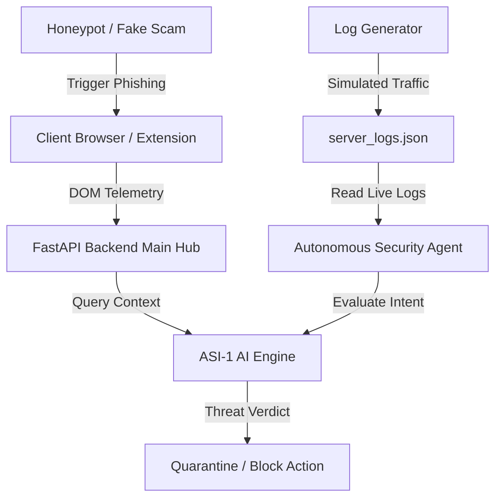
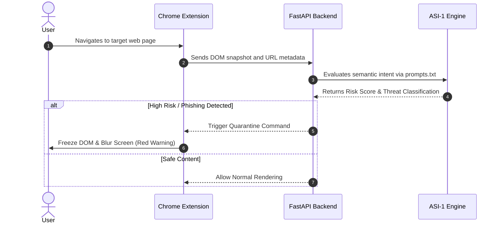
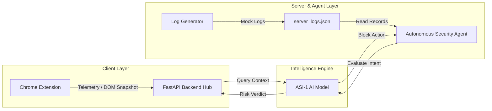

<div align="center">

# **Zero Trust WebGuardian**

A proactive dual-layer cybersecurity shield: browser-level zero-day phishing protection and autonomous server-side network defense. AI agents run the threat analysis, and a security officer approves every critical mitigation step.

---

## Demo Video

> **[Click to watch the live demo video on LinkedIN](https://lnkd.in/p/dP_3jfNi)** — Recorded live from the browser extension and backend agent interaction.

---
</div>


## Contents
1. [The Problem](#1-the-problem)
2. [What Zero Trust WebGuardian Does](#2-what-zero-trust-webguardian-does)
3. [Try It as a Judge](#3-try-it-as-a-judge)
4. [System Architecture](#4-system-architecture)
5. [How Threat Detection Works](#5-how-threat-detection-works)
6. [The AI Agents & Their Work](#6-the-ai-agents--their-work)
7. [Features](#7-features)
8. [Fake Reports & Misuse Prevention](#8-fake-reports--misuse-prevention)
9. [Reliability & Fallbacks](#9-reliability--fallbacks)
10. [Data Model & API Reference](#10-data-model--api-reference)
11. [Deployment & Local Run](#11-deployment--local-run)
12. [Project Structure](#12-project-structure)
13. [Limits & What’s Next](#13-limits--whats-next)
14. [Team & Credits](#14-team--credits)

---

## 1. The Problem

Traditional cybersecurity infrastructure is inherently reactive. Static blocklists take hours or days to flag newly minted zero-day phishing domains, leaving everyday users vulnerable during the critical window of a scam's launch. Meanwhile, server administrators are flooded with raw, uncontextualized network logs, making it impossible to manually triage sophisticated brute-force attacks or rapid port scans in real-time.

Relying solely on legacy heuristics leaves blind spots for dynamic social engineering and modern automated threats. **Zero Trust WebGuardian** shifts the paradigm from reactive filtering to proactive, AI-driven contextual verification across both the browser and backend server environments.

---

## 2. What Zero Trust WebGuardian Does

| Component | Target Audience | What They Get |
| --- | --- | --- |
| **Browser Extension** | End Users | Zero-click background DOM scanning that automatically freezes and blurs malicious phishing pages before credentials can be stolen. |
| **Autonomous Backend Agent** | System Administrators | A continuous background daemon that reads live server logs, analyzes intent via ASI-1, and instantly neutralizes malicious network traffic. |
| **Interactive Test Environment** | Evaluators / Judges | A built-in honeypot (`fake-scam.html`) and live log simulator to demonstrate end-to-end threat detection instantly. |

---

## 3. Try It as a Judge

* **Live App:** `http://localhost:8000` 
* **No login needed:** Open `fake-scam.html` to trigger the client-side phishing quarantine.

**A quick run, about 3 minutes:**

1. Start the FastAPI backend server: `uvicorn backend.main:app --reload`
2. Open the `fake-scam.html` file in your Chrome browser to test the client-side DOM quarantine.
3. Open a new terminal and run `python backend/log_generator.py` to simulate hacker traffic.
4. Run `python backend/agent.py` to watch the autonomous backend agent analyze logs and block threats using the ASI-1 model in real-time.

---

## 4. System Architecture



**How the pieces fit:**

* **One container, one process:** FastAPI serves the API bridge between the Chrome extension and the AI engine. The background agent runs concurrently to parse server log telemetry.
* **Stateless Prompt Execution:** Threat profiles are evaluated against carefully structured system instructions stored in `prompts.txt`, ensuring consistent intent evaluation rather than rigid keyword matching.
* **Atomic Response Handling:** Every detection cycle is logged instantaneously to provide immediate feedback to the extension or server daemon.

---

## 5. How Threat Detection Works



---

## 6. The AI Agents & Their Work

| Agent / Module | Runs On | Job |
| --- | --- | --- |
| **DOM Inspector** | Chrome Extension (Manifest V3) | Continuously monitors page contents without user friction, sending telemetry for Zero-Day threat assessment. |
| **ASI-1 Analyzer** | ASI-1 API (`/v1/chat/completions`) | Evaluates the *intent* of a webpage or server log, analyzing social engineering tactics beyond legacy blocklists. |
| **Autonomous Backend Agent** | Python Daemon (`agent.py`) | Reads live log files (`server_logs.json`), cross-references threat patterns, and issues real-time block commands. |
| **Log Simulator** | Python Script (`log_generator.py`) | Generates dummy network traffic (port scans, brute-force requests) for live testing and demonstration. |

---

## 7. Features

### For Everyday Users (Browser Extension)

* **Proactive Web Quarantine:** Zero-click background scanning of web pages that automatically freezes the DOM and blurs the screen if social engineering or phishing is detected.
* **Manual Analysis Tools:** An intuitive extension popup interface allowing users to manually inspect suspicious pages on demand.

### For System Administrators (Backend Agent)

* **Autonomous Threat Mitigation:** Background daemon that continuously monitors server logs and flags malicious network activities in real-time.
* **Real-time Console Feedback:** Immediate color-coded terminal alerts (Green for Allowed, Red for Blocked) detailing threat severity levels.

---

## 8. Fake Reports & Misuse Prevention

* **Sandboxed Testing:** Uses dedicated mock environments (`fake-scam.html` and `log_generator.py`) to safely test detection workflows without exposing production networks to live exploits.
* **Deterministic Fallbacks:** Ensures that even if external AI endpoints encounter latency, baseline heuristic safety rules maintain core protection structures.

---

## 9. Reliability & Fallbacks

* **Graceful Degradation:** If the primary ASI-1 model endpoint experiences latency or downtime, the system falls back to strict heuristic safety checks to maintain baseline protection.
* **Isolated Environment Testing:** Simulated traffic generators allow developers to benchmark detection rates against mock brute-force attacks and port scans safely.

---

## 10. Data Model & API Reference



### Core API Endpoints

| Route | Method | Access | Purpose |
| --- | --- | --- | --- |
| `/` | GET | Public | Landing page and system health status. |
| `/analyze` | POST | Extension | Evaluates DOM snapshots and URL metadata for phishing markers. |
| `/logs` | GET / POST | Admin | Manages live server log ingestion and tracking. |
| `/healthz` | GET | Anyone | Database and configuration integrity check. |

## 11. Deployment & Local Run

**Requirements:** Python 3.12+, an active ASI-1 API Key, and Google Chrome.

```bash
# Clone the repository
git clone https://github.com/YashAI060/Zero-Trust-Web-Guardian
cd Zero-Trust-Web-Guardian

# Navigate to backend and install dependencies
cd backend
pip install fastapi uvicorn requests python-dotenv

# Configure environment variables
cp .env.example .env  # Add your ASI_ONE_API_KEY inside .env

# Run the FastAPI server
uvicorn main:app --reload

```

### Installing the Chrome Extension

1. Open Google Chrome and navigate to `chrome://extensions/`.
2. Enable **Developer mode** using the toggle switch in the top-right corner.
3. Click **Load unpacked** in the top-left corner.
4. Select the `extension` folder from your local project directory.

---

## 12. Project Structure

```text
Zero-Trust-Guardian/
│
├── backend/                # Server-side & Autonomous Agent
│   ├── main.py             # FastAPI server connecting extension with AI
│   ├── agent.py            # Background agent monitoring server logs
│   ├── log_generator.py    # Simulator for dummy network traffic
│   ├── prompts.txt         # System instructions for the ASI-1 model
│   ├── server_logs.json    # Live log tracking file
│   └── .env                # API configuration (Create this file)
│
├── extension/              # Client-side Chrome Extension (Manifest V3)
│   ├── manifest.json       # Extension configuration & permissions
│   ├── background.js       # Service worker for zero-click auto-scanning
│   ├── popup.html          # Manual analysis UI template
│   ├── popup.js            # Manual analysis interaction logic
│   └── popup.css           # Styling for extension popups
│
└── fake-scam.html          # Honeypot page for live demonstration

```

---

## 13. Limits & What’s Next

* **Current Scope:** Optimized for single-node demonstration, local browser extension integration, and simulated log environments.
* **Future Roadmap:**
* Enterprise-grade dashboard for multi-server fleet management.
* Integration with SIEM tools (Splunk, Datadog) for centralized incident reporting.
* Expanded heuristic support for advanced multi-vector social engineering.


---

## 14. Team & Credits

* **Project Name:** Zero Trust WebGuardian
* **Built By Yash Raj & Jami Ahad submitted to API Innovate 2026 Hackathon**
* **Tech Stack:** Python, FastAPI, Uvicorn, JavaScript, Chrome Extension Manifest V3, ASI-1 API.
